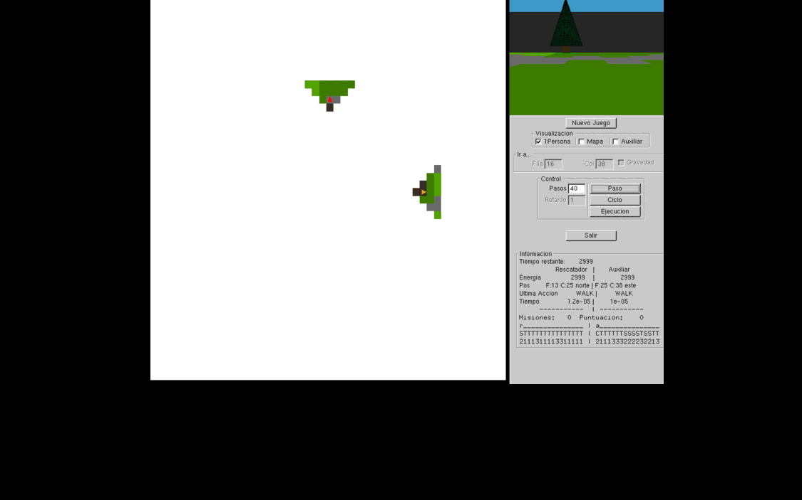
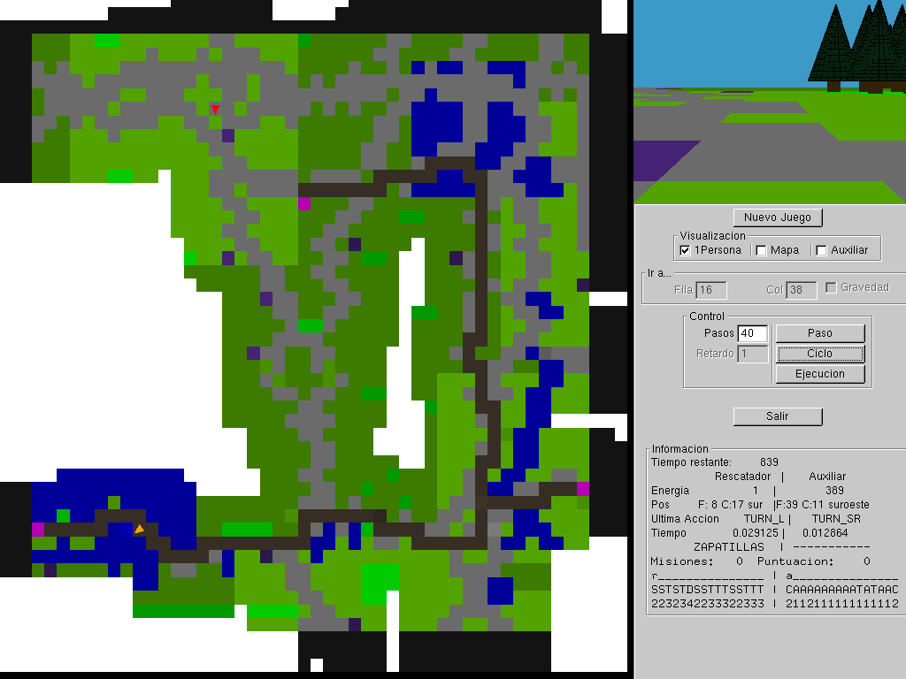

# 🧭 Agentes reactivos para exploración de mapas


Implementación de dos **agentes reactivos** en C++ que, sin conocer el mapa de antemano, se mueven por un mundo 2.5D con alturas, lo van descubriendo a medida que avanzan y tratan de **explorar el mayor porcentaje posible del terreno** en un número limitado de pasos.

Es la Práctica 2 de *Inteligencia Artificial* del Grado en Ingeniería Informática de la **Universidad de Granada** (curso 2024/2025).

<p align="center">
  
  <br>
  <em>El Rescatador (▲ rojo) y el Auxiliar (▲ naranja) descubriendo <code>mapa50</code> desde cero. Lo blanco es terreno todavía desconocido.</em>
</p>

---

## 📌 Mi aportación

El profesorado de la asignatura proporciona el **simulador** (motor del juego, interfaz gráfica en OpenGL/GLUI, sensores y mapas). Lo que hice yo es el **comportamiento de los agentes**, es decir, la lógica que en cada instante decide qué acción tomar a partir de lo que perciben los sensores:

| Fichero | Contenido |
|---|---|
| [`Comportamientos_Jugador/rescatador.cpp`](Comportamientos_Jugador/rescatador.cpp) / [`.hpp`](Comportamientos_Jugador/rescatador.hpp) | Agente **Rescatador**, niveles 0 y 1 |
| [`Comportamientos_Jugador/auxiliar.cpp`](Comportamientos_Jugador/auxiliar.cpp) / [`.hpp`](Comportamientos_Jugador/auxiliar.hpp) | Agente **Auxiliar**, niveles 0 y 1 |

El resto del repositorio (`src/`, `include/`, `bin_src/`, `mapas/`) es el entorno de simulación sobre el que se ejecutan los agentes.

## 🎯 El problema

Hay dos agentes en un mapa cuadriculado que no conocen. Cada casilla tiene un tipo de terreno y una altura (cota):

| Código | Terreno | | Código | Terreno |
|:---:|---|---|:---:|---|
| `C` | Camino | | `B` | Bosque |
| `S` | Sendero | | `A` | Agua |
| `X` | Puesto base (objetivo) | | `P` | Precipicio |
| `D` | Zapatillas | | `M` | Muro |

**Lo que perciben los agentes.** Un cono de visión de **16 casillas** delante de ellos (3 filas de profundidad) con la superficie, la altura y si hay otro agente en cada casilla, además de su posición y su orientación (8 direcciones posibles).

**Lo que pueden hacer.** Avanzar (`WALK`) y girar. El Rescatador gira 90° a la izquierda (`TURN_L`) y 45° a la derecha (`TURN_SR`). El Auxiliar solo puede girar 45° a la derecha.

**Restricciones físicas.** Solo pueden pasar a una casilla cuya altura difiera en 1 como mucho de la actual. El Rescatador puede salvar desniveles de 2 si ha recogido unas **zapatillas** (`D`). Además, ninguno de los dos puede pisar la casilla en la que esté el otro.

**Objetivos:**

- **Nivel 0.** Llegar al puesto base (`X`) yendo únicamente por caminos.
- **Nivel 1.** Descubrir el **máximo porcentaje posible de caminos y senderos** del mapa en 3000 instantes de simulación.

## 🧠 Cómo funciona

Los dos agentes siguen una arquitectura **reactiva con memoria de estado**. En cada instante el ciclo tiene dos fases:

```
 ┌─────────────────────────┐      ┌───────────────────────────────┐
 │ 1. Percibir y recordar  │ ───▶ │ 2. Decidir la acción          │
 │  · proyectar el cono de │      │  · filtrar casillas viables   │
 │    visión sobre el mapa │      │  · priorizar: objetivo >      │
 │  · contar las visitas   │      │    zapatillas > menos visitada│
 │    de cada casilla      │      │  · romper bucles con umbral   │
 └─────────────────────────┘      └───────────────────────────────┘
```

### 1. Construcción del mapa a partir de los sensores
`SituarSensorEnMapaR` y `SituarSensorEnMapaA` pasan las 16 lecturas del cono de visión a **coordenadas absolutas** del mapa para cada una de las 8 orientaciones. En las orientaciones diagonales (NE, SE, SO, NO) el cono tiene forma de "L" escalonada en lugar de triángulo, así que se recorre de forma distinta. Así se rellenan a la vez el mapa de superficie y el mapa de alturas.

### 2. Memoria de visitas
Cada agente guarda una **matriz de visitas** del tamaño del mapa que funciona como mapa de calor: cuenta cuántas veces ha pisado cada casilla. Con ella, el agente sabe qué casillas de su entorno inmediato ya conoce bien y cuáles todavía no.

### 3. Filtro de viabilidad
Antes de decidir, las tres casillas de delante (izquierda, centro y derecha) pasan por `ViableR` / `ViableA`. Esta función marca como no transitables las que tienen un desnivel excesivo (teniendo en cuenta si el Rescatador lleva zapatillas) y las que ocupa el otro agente, para que no choquen.

### 4. Selección de la casilla más interesante
Entre las casillas viables, el agente elige siguiendo este orden de prioridad:
1. El **puesto base** `X`, si lo tiene a la vista (nivel 0).
2. Las **zapatillas** `D`, si todavía no las tiene (Rescatador).
3. El camino o sendero **menos visitado**. Para elegirlo se ordenan las casillas por número de visitas con un `stable_sort`, de modo que en caso de empate se prefiere seguir recto, después la izquierda y por último la derecha. Así se evitan zigzags innecesarios.

### 5. Escapar de los bucles
Si las casillas de alrededor superan un **umbral de visitas** (5 en el Rescatador y 10 en el Auxiliar), el agente deja de considerarlas atractivas y gira para buscar otra salida. Si da una vuelta completa sin encontrar ninguna casilla por debajo del umbral, se **relaja la restricción** temporalmente para no quedarse bloqueado en un callejón sin salida.

### 6. Giros compuestos
Como cada agente tiene un repertorio de giros limitado, el giro de 45° a la izquierda se construye combinando acciones y guardando el estado intermedio:
- **Rescatador:** `TURN_L` (−90°) + `TURN_SR` (+45°) = −45°.
- **Auxiliar:** 7 × `TURN_SR` (7 × 45° = 315°) = −45°.

## 📊 Resultados

Porcentaje de caminos y senderos descubiertos en el **nivel 1** (semilla 1, 3000 instantes), ejecutando en modo sin gráficos:

| Mapa | Tamaño | Descubierto |
|---|:---:|:---:|
| `mapa30` | 30×30 | **100 %** |
| `mapa50` | 50×50 | **100 %** |
| `islas25` | 100×100 | 76,5 % |
| `mapa75` | 75×75 | 74,9 % |
| `bosque_prohibido` | 30×30 | 67,5 % |
| `luminalia25` | 100×100 | 65,5 % |
| `mapa100` | 100×100 | 62,8 % |

> Los resultados cambian según la posición inicial de cada agente. Abajo están los comandos exactos para reproducirlos.

<p align="center">
  
</p>

## 🚀 Compilación y ejecución

**Requisitos (Linux):** `g++` con C++17, `cmake`, `freeglut`, `libjpeg`, `libxmu`, `libxi` y OpenMP.

```bash
git clone https://github.com/joseaguilaar/practica2.git
cd practica2
./install.sh          # instala las dependencias (apt/dnf/pacman) y compila
```

Si ya tienes las dependencias instaladas, basta con:

```bash
cmake -DCMAKE_BUILD_TYPE=Release . && make
```

Se generan dos ejecutables:

```bash
# Con interfaz gráfica (permite elegir mapa y nivel desde el menú)
./practica2

# Con interfaz gráfica, cargando directamente una partida
./practica2 mapas/mapa50.map 1 1 14 25 0 25 37 2

# Sin interfaz gráfica (muestra el resultado por consola)
./practica2SG mapas/mapa50.map 1 1 14 25 0 25 37 2
```

Los parámetros son: `mapa semilla nivel filaR colR orientR filaA colA orientA`, donde `R` es el Rescatador, `A` el Auxiliar y la orientación va de 0 a 7 (0 = norte, 1 = noreste, 2 = este, …).

<details>
<summary>Comandos usados para la tabla de resultados</summary>

```bash
./practica2SG mapas/mapa30.map           1 1 16 15 0 15 17 2
./practica2SG mapas/mapa50.map           1 1 14 25 0 25 37 2
./practica2SG mapas/mapa75.map           1 1 35 37 0 36 39 2
./practica2SG mapas/mapa100.map          1 1 50 50 0 47 50 2
./practica2SG mapas/islas25.map          1 1 50 50 0 47 50 2
./practica2SG mapas/bosque_prohibido.map 1 1 17 15 0 12 15 2
./practica2SG mapas/luminalia25.map      1 1 45 50 0 50 55 2
```
</details>

## 📁 Estructura del repositorio

```
.
├── Comportamientos_Jugador/   ← mi implementación (Rescatador y Auxiliar)
├── mapas/                     mapas de prueba (.map)
├── src/ · include/            simulador: motor de juego, gráficos 3D, GUI (GLUI)
├── bin_src/                   puntos de entrada (con y sin interfaz gráfica)
├── ply/                       modelos 3D usados por el visor
├── docs/img/                  capturas y GIF de este README
├── CMakeLists.txt
└── install.sh
```

## 🛠️ Lo que trabajé en esta práctica

- Diseño de **agentes reactivos** con estado interno: percepción, memoria y decisión.
- Heurísticas de **exploración** en entornos parcialmente observables: memoria de visitas, prioridades y mecanismos para salir de bucles y callejones.
- **Geometría discreta** para proyectar un campo de visión con 8 orientaciones sobre una cuadrícula.
- Trabajo sobre una **base de código C++ grande y ajena**: entender su API (`Sensores`, `Action`, `Comportamiento`) y extenderla sin tocar el motor.
- C++17 (STL, `stable_sort` con lambdas), CMake y depuración en Linux.

## 🙏 Créditos

El simulador, los mapas y el enunciado son del profesorado del Departamento de Ciencias de la Computación e Inteligencia Artificial (DECSAI) de la Universidad de Granada. El código de los agentes de la carpeta `Comportamientos_Jugador/` (Rescatador y Auxiliar) es mío.

---

<p align="center">Hecho por <a href="https://github.com/joseaguilaar">@joseaguilaar</a></p>
